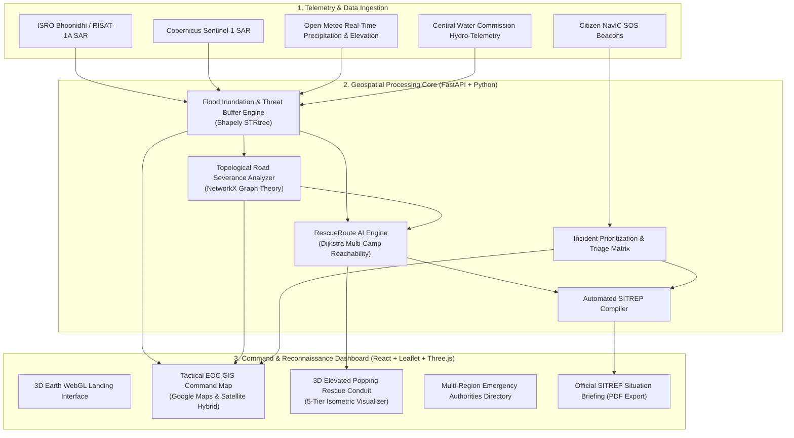
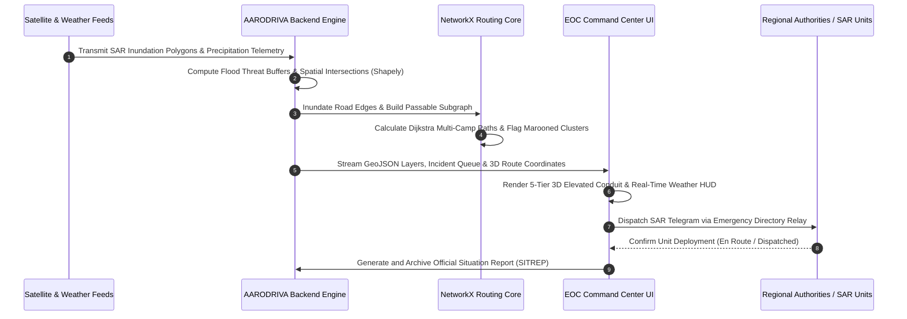
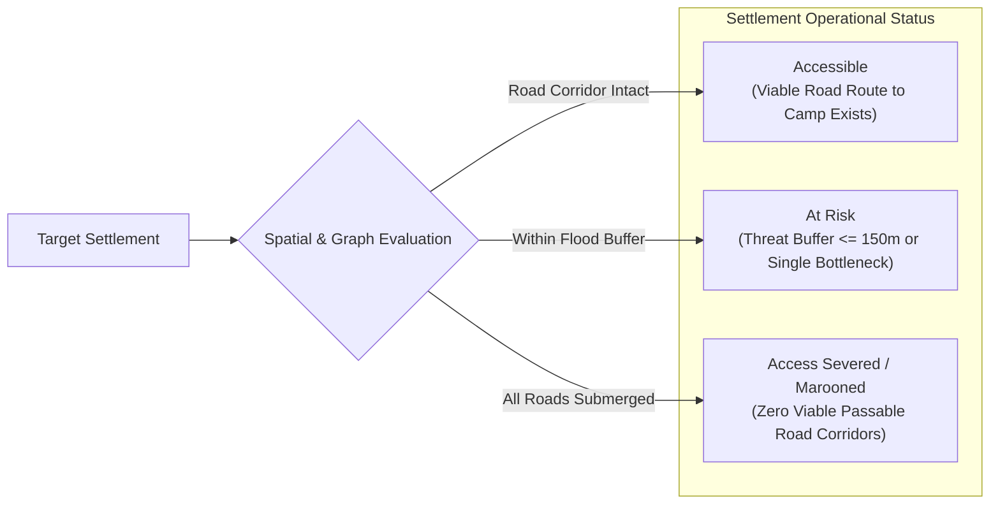

# AARODRIVA AI
### Satellite-to-Rescue Geospatial Intelligence Platform for Flood Disaster Operations

---

## 1. Executive Summary

**AARODRIVA AI** is an enterprise-grade geospatial emergency intelligence platform designed to operationalize satellite remote sensing data for mission-critical flood disaster response. The platform bridges Earth Observation satellite feeds (including ISRO Bhoonidhi RISAT-1A SAR, Copernicus Sentinel-1, and Open-Meteo hydrological telemetry) directly with tactical search-and-rescue (SAR) workflows.

The system addresses four fundamental operational requirements in disaster logistics:
1. **Detection (Satellite Radar GIS):** Real-time inundation mapping derived from Synthetic Aperture Radar (SAR) imagery, radar backscatter thresholds, and real-time precipitation gauges.
2. **Identification (Topological Settlement Analysis):** Automated detection of marooned human settlements where floodwaters have severed road access networks, independent of whether the village center itself is submerged.
3. **Logistics Optimization (3D Elevated RescueRoute AI):** Dynamic graph-theoretic pathfinding utilizing Dijkstra algorithms to compute elevated, high-ground evacuation routes bypassing submerged infrastructure.
4. **Command Synchronization (Automated SITREP & Inter-Agency Relay):** Automated generation of formal Emergency Operations Centre (EOC) Situation Reports with PDF export and a multi-region emergency authorities directory.

---

## 2. System Architecture

The following diagram illustrates the end-to-end data processing pipeline, from satellite and hydrological ingestion to geospatial processing and tactical presentation.



---

## 3. Operational Workflow

The sequence below outlines the operational flow from initial disaster telemetry detection to field asset dispatch.



---

## 4. Key Functional Modules

### 4.1. 3D Elevated RescueRoute AI Engine
Unlike conventional 2D flat polyline overlays, AARODRIVA features a proprietary 5-tier isometric visualizer that renders evacuation routes with high contrast and depth over terrain:
* **Tier 1 (Isometric Ground Shadow):** Offset coordinate projection rendering an 18px cast shadow on the underlying terrain, visually elevating the pipeline.
* **Tier 2 (Structural Casing):** Dark high-contrast chassis underlay preventing visual blending on satellite basemaps.
* **Tier 3 (Neon Halo Ring):** High-luminance cyan glow delineating the designated safe transit corridor.
* **Tier 4 (Core Conduit):** Laser emerald conduit line representing the verified dry road surface.
* **Tier 5 (Dynamic Energy Pulse):** Continuous SVG stroke-dash animation indicating the directed flow of convoy evacuation.
* **Topographic Safety Telemetry:** Displays precise clearance metrics (e.g., `+3.4m above flood mark`), elevation checkpoints, distance, and estimated travel times.

### 4.2. Topological Marooned Settlement Detection
A village located on dry ground can still be entirely cut off if all ingress and egress corridors are flooded. AARODRIVA applies graph theory to categorize human habitations into three operational tiers:



| Classification | Operational Meaning | Graph and Spatial Criteria |
| :--- | :--- | :--- |
| **Accessible** | Viable route exists; road connection intact | At least one unflooded road route exists to an operational rescue camp; settlement is outside the flood threat buffer. |
| **At risk** | Threatened connectivity or partial cut | Viable route to a camp exists, but settlement lies within flood threat buffer (depth threshold or distance $\le 150\text{ m}$), or relies on a single unflooded link. |
| **Access severed** | **Marooned** (Isolated) | **Zero viable mapped road corridors** exist to any operational rescue camp through unflooded roads. Requires aerial or watercraft deployment. |

### 4.3. Worldwide Real-Time Telemetry and Global Scaling
AARODRIVA is fully decoupled from single-region constraints:
* **Universal Geographic Reach:** Any coordinate pair globally can be queried or clicked on the map interface.
* **Live Telemetry Integration:** Queries Open-Meteo and global hydrological models to retrieve live rainfall rates (mm/h) and surface elevation (meters above sea level).
* **Automated Safety Corridor Generation:** For any global location, the system synthesizes dynamic local flood polygons and calculates an elevated Dijkstra route from the nearest operational high-ground staging post.

### 4.4. Multi-Region Emergency Authorities Directory
The directory automatically synchronizes with the geographic location active on the command map and offers manual switching across global jurisdictions:
* **India (Assam & Northeast):** NDRF 1st Bn, SDRF Assam, ASDMA State Command, Kamrup Metro EOC, Mrityunjoy 108 Ambulance, IAF Borjhar SAR, Inland Waterways Authority.
* **India (Maharashtra & Mumbai):** NDRF 5th Bn, BMC Disaster Control (1916), Indian Coast Guard West, 108 MEMS Ambulance, Western Naval Command.
* **India (Delhi-NCR & North):** NDRF 8th Bn, DDMA State Control (1077), Central Water Commission Flood Room, Delhi Fire Service (101).
* **United States:** FEMA National Response Coordination Center (NRCC), US Coast Guard National SAR Command (1-800-424-8802 / VHF Ch 16), US Army Corps of Engineers, NOAA National Weather Center.
* **Spain / Mediterranean:** Unidad Militar de Emergencias (UME), 112 Comunitat Valenciana, Proteccion Civil Espana, Cruz Roja Espanola.
* **United Kingdom:** UK Environment Agency Floodline (0345 988 1188 / 0800 80 70 60), HM Coastguard NMOC, London Resilience Tactical Command.
* **Japan:** Tokyo Metropolitan Disaster Prevention Division, Japan Coast Guard (118), Fire and Disaster Management Agency (FDMA 119).
* **Australia:** State Emergency Service (SES: 132 500), Triple Zero (000), Australian Maritime Safety Authority (AMSA SAR).
* **South America (Brazil):** Defesa Civil Nacional (Disque 199), Corpo de Bombeiros Militar (193 SAR), CENAD.
* **Global International:** UN OCHA ReliefWeb, INSARAG Global Search and Rescue Network, IFRC Geneva.

---

## 5. Technology Stack

```
Frontend Architecture:
  Framework:        React 19 (Vite Build Pipeline)
  Mapping Engine:   Leaflet / React-Leaflet with Custom SVG Projection
  3D Graphics:      Three.js WebGL (Interactive Planetary Visualization)
  Styling:          Tailwind CSS (Tactical Dark Command Aesthetic)
  Document Export:  jsPDF + HTML2Canvas Automated Formatter

Backend Architecture:
  Framework:        FastAPI (Python 3.11+)
  Spatial Compute:  Shapely (Spatial Predicates, STRtree Indexing, Buffering)
  Graph Analytics:  NetworkX (Graph Topology, Edge Severance, Dijkstra Pathfinding)
  Data Persistence: SQLite with SQLAlchemy ORM (Incident Event Store)
  Validation:       Pydantic v2 Schema Modeling
```

---

## 6. Installation and Setup

### 6.1. Prerequisites
* Python 3.11 or higher
* Node.js 18.0 or higher
* npm or pnpm

### 6.2. Backend Setup
```bash
# Navigate to backend directory
cd backend

# Install dependencies
pip install -r requirements.txt

# Launch FastAPI server
python main.py
```
* Backend endpoint: `http://localhost:8000`
* Interactive API Documentation (OpenAPI/Swagger): `http://localhost:8000/docs`

### 6.3. Frontend Setup
```bash
# Navigate to frontend directory
cd frontend

# Install packages
npm install

# Start development server
npm run dev

# Or build for production deployment
npm run build
```
* Command Center URL: `http://localhost:5173`

### 6.4. Verification and Test Suite
```bash
# Run multi-continent location detection test across 38 global cities
python tests/test_global_places_detection.py

# Run graph-theoretic routing test
python tests/test_routing.py

# Run settlement isolation audit
python tests/audit_features.py
```

---

## 7. API Reference

| Method | Endpoint | Description |
| :--- | :--- | :--- |
| `GET` | `/api/health` | Health check and system readiness probe |
| `GET` | `/api/flood-zones` | Retrieves GeoJSON polygons of active satellite flood inundation |
| `GET` | `/api/settlements` | Returns settlements with population, risk score, and isolation status |
| `GET` | `/api/analysis/marooned` | Identifies villages with severed road connections |
| `GET` | `/api/analysis/marooned/full` | Full diagnostic report with GeoJSON road states and reachability |
| `GET` | `/api/analysis/marooned/blocked-roads` | GeoJSON of all submerged or severed road segments |
| `POST` | `/api/routes` | Computes Dijkstra high-ground evacuation path avoiding flood zones |
| `POST` | `/api/predict/location` | Real-time risk and routing calculation for arbitrary global coordinates |
| `GET` | `/api/sos` | Retrieves active citizen SOS distress beacons |
| `POST` | `/api/sos` | Ingests new citizen distress call with GPS coordinates and headcount |
| `POST` | `/api/incidents/{id}/dispatch`| Updates tactical asset dispatch status for an incident |
| `GET` | `/api/metrics` | Returns aggregated operational metrics and triage counters |
| `GET` | `/api/reports/sitrep` | Compiles formal Emergency Operations Centre Situation Report |

---

## 8. License

This project is licensed under the Apache License 2.0. See the `LICENSE` file for details.
